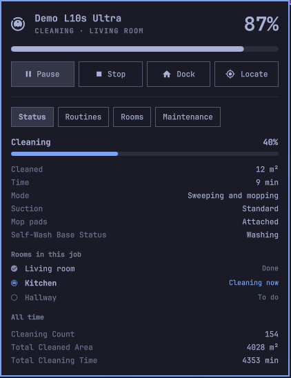

<div align="center">

# Dreame Vacuum for Omarchy

**Control your Dreame robot vacuum from the [Omarchy](https://omarchy.org) bar.
No Home Assistant needed.**

[](LICENSE)
[](https://omarchy.org)



<sub>Shown with the bundled demo robot (<code>tests/fake-dreame-vacuum</code>).</sub>

</div>

## Features

- Start/pause, stop, dock and locate. Middle-click the bar icon to start or pause.
- **Status:** the current job room by room, what the dock is doing, and all-time totals.
- **Routines:** one click for your usual jobs, each with its own rooms, mode, suction and passes.
- **Rooms:** pick rooms, a mode and suction, and clean.
- **Map:** live, zoomable map.
- **Maintenance:** brushes, filter and other consumables.
- Notifies when a job is really done (not when the robot docks mid-job to wash its pads or recharge) and on errors.
- Follows your theme and language (English, Dutch).

## Requirements

- A Dreame robot on a Dreamehome account
- Python 3 and curl (`setup` installs them if missing)

## Installation

```bash
omarchy plugin add https://github.com/opteon-sdc/omarchy-dreame-vacuum --enable
~/.config/omarchy/plugins/io.github.opteon-sdc.dreame/setup
```

`setup` installs the `dreame-vacuum` command and its user service, and asks for your
Dreamehome login. Log in again later with `dreame-vacuum login`.

To remove it:

```bash
systemctl --user disable --now dreame-vacuum
omarchy plugin remove io.github.opteon-sdc.dreame
rm -rf ~/.local/share/dreame-vacuum ~/.local/bin/dreame-vacuum ~/.config/dreame-vacuum
```

## Usage

Click the robot icon in the bar.

| Key | Action |
|---|---|
| `Space` | Start/pause |
| `S` | Stop |
| `H` | Dock |
| `L` | Locate |
| `1`–`9` | Run a routine |
| `←` / `→` | Switch tabs |
| `+` / `−` / `0` | Zoom the map / show the whole map |
| `Esc` | Close |

Keybinding example for `~/.config/hypr/bindings.lua`:

```lua
o.bind("SUPER + ALT + V", "Vacuum start/pause", "omarchy-shell dreame playPause")
o.bind("SUPER + ALT + L", "Vacuum the living room", "omarchy-shell dreame routine living")
```

IPC: `omarchy-shell dreame open | close | toggle | start | pause | playPause | stop | dock | locate | routine <id>`.

### Routines

Edit `~/.config/dreame-vacuum/routines.json` (`setup` writes an example):

```json
{
  "routines": [
    { "id": "living", "name": "Living", "rooms": ["Living Room"], "mode": "mopping_after_sweeping" },
    { "id": "night", "name": "Bedrooms", "rooms": ["Primary Bedroom", "Bathroom"], "mode": "sweeping", "suction": "strong" }
  ]
}
```

- `rooms`: names as `dreame-vacuum rooms` lists them, or room ids
- `mode`: `sweeping`, `mopping`, `sweeping_and_mopping`, `mopping_after_sweeping`
- `suction`: `quiet`, `standard`, `strong`, `turbo`
- `repeats`: 1–3

`mode` and `suction` are optional and default to the robot's current settings. A mode
only applies when "customized cleaning" and CleanGenius are off in the Dreame app.

### Command line

```bash
dreame-vacuum status
dreame-vacuum start | pause | stop | dock | locate
dreame-vacuum routine living
dreame-vacuum clean-rooms 1 3 --mode sweeping --suction turbo --repeats 2
```

`dreame-vacuum --help` lists everything.

## Settings

Set with `omarchy bar set io.github.opteon-sdc.dreame <key> <value>`.

| Key | Default | Description |
|---|---|---|
| `barLabel` | `cleaning` | Battery next to the icon: `cleaning`, `always`, `never` |
| `notify` | `true` | Notifications when a job ends or on errors |
| `defaultTab` | `status` | `status`, `routines`, `rooms`, `map`, `care` |
| `showMap` | `true` | Show the map tab |
| `panelWidth` | `420` | Panel width in pixels |
| `cliPath` | `dreame-vacuum` on `PATH` | Path to the CLI |

## How it works

```
bar panel ──► dreame-vacuum ──► dreame-vacuum serve ──► Dreamehome cloud ──► robot
              (client)          (user service, Tasshack's dreame library)
```

The service keeps one connection to the robot open, so commands respond immediately and
notifications go out once, however many bars you have. Your login is stored in
`~/.config/dreame-vacuum/config.json` (mode 600).

## Troubleshooting

```bash
systemctl --user status dreame-vacuum
journalctl --user -u dreame-vacuum -f
```

## Development

`tests/check.sh` runs the checks. To try the panel without a robot:

```bash
omarchy bar set io.github.opteon-sdc.dreame cliPath "$PWD/tests/fake-dreame-vacuum"
```

## License

[MIT](LICENSE). Device protocol, map renderer and translations come from
[Tasshack/dreame-vacuum](https://github.com/Tasshack/dreame-vacuum) (MIT), which
`setup` downloads. Not affiliated with Dreame Technology.
